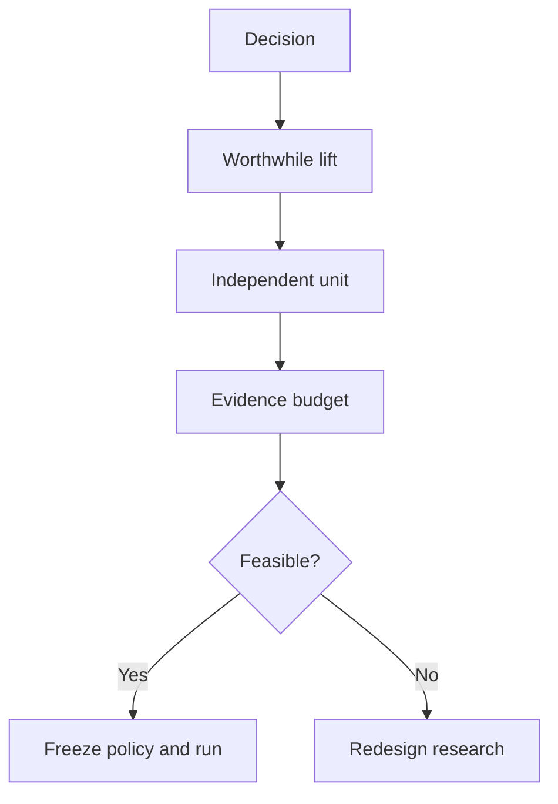

2026-11-26 | AI Power Skill #33 | Minimum-Detectable-Effect Contracts

**Category:** data analysis; evaluation and verification; experimentation

**Core principle:** Before asking an Artificial Intelligence (AI) system to choose a winning variant, precommit the smallest difference worth detecting and calculate how much independent evidence the decision requires.

## What the capability is

A **minimum-detectable-effect contract** is a versioned experiment policy created before results are inspected. It specifies:

- the independent unit, such as one account;
- the primary binary outcome;
- an evidence-backed baseline rate;
- the minimum detectable effect (MDE), meaning the smallest lift worth acting on;
- the false-positive rate (`alpha`) and desired statistical power;
- allocation, exclusions, and the stopping rule.

Those inputs produce an evidence budget per variant and in total. If the required sample is not feasible, the correct response is to redesign the question or use a different research method—not to run a tiny test and declare the prettiest chart a winner.

For two independent conversion proportions, a common planning method converts the rates to Cohen's h and estimates the sample needed for a two-sample normal test. It is a planning approximation, not proof that assignment, independence, attribution, or business value is valid.

## Why it matters

AI can create many landing pages, messages, and product variants quickly. Evidence remains expensive. Without a precommitted evidence budget, teams often stop early, count repeated behavior as independent observations, choose the effect size after seeing results, or celebrate a difference too small to matter.

The contract answers a higher-leverage question before launch: **Can this experiment realistically resolve the business decision?**

## What makes it non-obvious

1. **MDE is a decision threshold, not a prediction.** “We expect a five-point lift” differs from “a lift below five points would not justify the change.”
2. **The denominator can invalidate the test.** Several sessions from one account are not necessarily several independent observations.
3. **No significant difference is not equivalence.** An underpowered test may miss a real effect.
4. **Extra variants increase evidence cost.** AI makes variants cheap to produce, not cheap to compare reliably.
5. **Power cannot repair bad assignment.** Contamination, duplicate units, missing outcomes, or a weak metric still invalidate the decision.

## How advanced users apply it

| Typical approach | Advanced approach |
|---|---|
| Inspect clicks until one variant leads | Freeze a primary outcome and evidence boundary |
| Count sessions | Declare and deduplicate the independent unit |
| Use default confidence settings | Justify alpha, power, MDE, and allocation |
| Add many AI variants | Test the smallest decision-relevant contrast |
| Treat a null result as “same” | Report what effect the test could detect |

## Immediate uses

- A software company can test a control and challenger signup message using unique accounts and activated trials as the outcome.
- A sales team can compare two outreach sequences on qualified replies rather than opens.
- A marketplace can test ranking changes at the buyer level while controlling repeat sessions.
- A support agent team can compare task completion by user rather than message volume.

## Tool/Plugin Opportunity

**Option:** ChatGPT Data Analysis or a spreadsheet, plus GitHub for the frozen policy.

**Unlock:** build a sensitivity table showing how the evidence requirement changes across plausible baselines and worthwhile lifts.

**Setup:** no new paid service is required. Use aggregate or fictional data when customer-level rows are unnecessary.

**Concrete use case:** compare three MDE scenarios for a fictional signup experiment and commit the chosen policy before exposing either variant.

**Authoritative references:** [NIST sample sizes for testing proportions](https://itl.nist.gov/div898/handbook/prc/section2/prc242.htm), [NIST comparison of two proportions](https://www.itl.nist.gov/div898/handbook/prc/section3/prc33.htm), [`statsmodels` normal power solver](https://www.statsmodels.org/stable/generated/statsmodels.stats.power.NormalIndPower.solve_power.html), and [`statsmodels` proportion effect size](https://www.statsmodels.org/devel/generated/statsmodels.stats.proportion.proportion_effectsize.html).

## Practice reps

Practice status is **PENDING** until evidence is recorded.

### Rep 1 — Define the unit

For one proposed experiment, write the independent unit, primary binary outcome, baseline source, and smallest lift worth acting on. Name two invalid denominators.

### Rep 2 — Sensitivity table

Hold alpha at 0.05 and power at 0.80. Calculate evidence requirements for three worthwhile lifts around the same baseline. Explain why detecting a smaller lift requires more observations.

### Rep 3 — Precommit the policy

Draft a full contract for a fictional two-variant signup experiment: account-level assignment, activated-trial outcome, baseline range, MDE, exclusions, allocation, and stopping rule. If the evidence requirement is infeasible, redesign the research question without weakening the threshold after seeing results.

## Retention check

From **Precommitted Evidence Gates**: which fields must be frozen before outcome inspection? From **Leakage-Proof As-Of Evaluation**: why can data that arrived after the planning cutoff not be silently added to the original baseline?

## Daily challenge

Before viewing results for one proposed experiment, write a seven-field contract: decision, independent unit, primary outcome, baseline source, minimum worthwhile lift, alpha/power, and stopping rule. Calculate—or mark unknown—the evidence requirement. If any field is unknown, do not declare a winner.

## Learning ledger

| Skill | Practice | Evidence | Next step |
|---|---|---|---|
| Minimum-Detectable-Effect Contracts | PENDING | None yet | Complete one pre-outcome contract and retain its timestamped artifact |

This lesson is educational, uses generic scenarios, and does not authorize project mutations. A learner must establish their own permissions, privacy rules, budget, and review gates before applying it.
